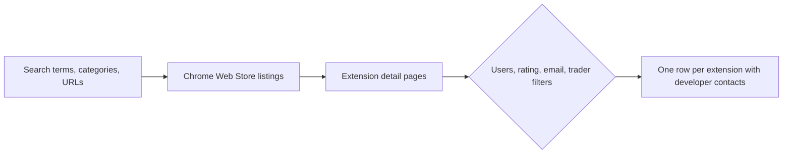

# Chrome Web Store Scraper: Extension Data and Developer Leads

[](https://apify.com/Turboextract/chrome-extension-leads)
[](LICENSE)
[](#pricing)

**Scrape Chrome extensions by search term, category or URL and get users, rating, reviews, version, last update and the developer's published contact details: company name, address, website, email and phone.** Filter by user count, rating or email to build a list of extension makers, or track competitors in your category.

Google asks every developer to publish contact details on the listing, and businesses that declare themselves EU traders add an address and phone. A single search for "crm" returned Grammarly-sized giants and small teams alike: Copper (40,000 users), Streak (700,000) and Zoho, each with a support email and website.

**Try it now →** [apify.com/Turboextract/chrome-extension-leads](https://apify.com/Turboextract/chrome-extension-leads)

---

## Why this exists

- Every Chrome extension lists its developer's website and email, and businesses add an address and phone.
- The store has no export and shows details one listing at a time.
- Users, ratings and release dates are the best public signal of an extension's traction.
- Extension analytics tools charge monthly.

---

## Who this is for

- **SaaS and agency sales teams** selling to extension developers: payments, analytics, localization, security reviews
- **Investors and acquirers** looking for extensions with real users and an active developer
- **Product managers** tracking competitors' users, ratings and release cadence
- **Marketers** finding extensions to partner with or advertise on
- **Researchers** measuring a category's size and quality

---

## What you get per extension

```json
{
  "extensionId": "hpfmedbkgaakgagknibnonpkimkibkla",
  "name": "Copper CRM for Gmail and LinkedIn",
  "url": "https://chromewebstore.google.com/detail/hpfmedbkgaakgagknibnonpkimkibkla",
  "category": "Workflow & Planning",
  "users": 40000,
  "rating": 3.6,
  "ratingsCount": 387,
  "version": "2.0.521",
  "updated": "November 17, 2026",
  "size": "10.06MiB",
  "developer": {
    "name": "Copper CRM Inc.",
    "address": "2021 Fillmore St PMB2118 San Francisco, CA 94115 US",
    "website": "https://copper.com",
    "email": "support+crx@copper.com",
    "phone": "+1 415-231-6360",
    "isTrader": true,
    "dunsNumber": "078644995"
  }
}
```

---

## How it works



The actor reads the public Chrome Web Store pages with plain HTTP requests. No login, no browser, no proxies.

---

## Quick start

1. Click **Try for free**.
2. Add **Search terms** like `crm` or `email finder`, or **Categories** like `productivity/tools`.
3. Optional: set **Min users**, tick **Only with developer email** or **Traders only**.
4. Click **Start** and export to CSV or your CRM.

### API

```bash
curl -X POST "https://api.apify.com/v2/acts/Turboextract~chrome-extension-leads/run-sync-get-dataset-items?token=YOUR_TOKEN" \
  -H "Content-Type: application/json" \
  -d '{
    "searchQueries": ["crm", "linkedin"],
    "minUsers": 1000,
    "requireEmail": true
  }'
```

### Python

```python
from apify_client import ApifyClient

client = ApifyClient("YOUR_TOKEN")
run = client.actor("Turboextract/chrome-extension-leads").call(run_input={
    "categories": ["productivity/tools", "productivity/workflow"],
    "traderOnly": True,
})
for ext in client.dataset(run["defaultDatasetId"]).iterate_items():
    print(ext["name"], ext["users"], ext["developer"]["email"], ext["developer"]["website"])
```

---

## Input fields

| Field | Default | What it does |
|---|---|---|
| `searchQueries` | – | Chrome Web Store searches |
| `categories` | – | e.g. productivity/tools, lifestyle/shopping |
| `extensionUrls` | – | Listing links or 32-letter IDs |
| `minUsers` / `maxUsers` | 0 | User count range |
| `minRating` | 0 | 1 to 5 |
| `requireEmail` | false | Only developers with an email |
| `traderOnly` | false | Only EU-declared traders (businesses) |
| `maxResults` | 100 | Cap per run |

---

## Pricing

**$0.003 per extension delivered, developer details included.** 1,000 extension leads cost $3.

| Option | 1,000 extensions with developer contacts |
|---|---|
| **Chrome Web Store Scraper** | **$3** |
| Other Chrome Web Store actors on Apify | $1.20 to $8, details often charged extra |
| Extension analytics tools | Monthly subscriptions |
| Copying listings by hand | Hours |

---

## Common use cases

- **Lead lists**: every CRM, SEO or LinkedIn extension with more than 1,000 users and a developer email
- **Competitor tracking**: run weekly on your rivals' IDs to see users, ratings and new versions
- **Acquisition sourcing**: well-rated extensions with 10,000 to 100,000 users
- **Partnerships**: extensions in your niche whose makers you can pitch an integration
- **Security reviews**: popular extensions in a category for a permissions audit

---

## Tips for best results

- Use several specific search terms rather than one broad one, since each search returns about 10 to 30 results.
- Set `maxUsers` to find small teams whose developers answer their email.
- Use `traderOnly` for registered businesses with a postal address.
- Dedupe on `extensionId` across runs.

---

## Pairs well with

- [B2B Lead Enrichment Pipeline](https://apify.com/Turboextract/b2b-lead-enrichment-pipeline): turn the developer's website into a company profile
- [GitHub Trending Repos](https://apify.com/Turboextract/github-trending-repos): fast-growing open-source projects and their owners
- [Brand Availability Check](https://apify.com/Turboextract/brand-availability-check): check a name before you launch your own extension

---

## FAQ

**Where does the email come from?** The developer publishes it on the listing's Details section. Some developers list only a website.

**What does "trader" mean?** Under EU rules, developers who sell to consumers as a business declare themselves traders and must show an address and contact details.

**How many results does a search return?** The store shows about 10 to 30 extensions per search or category page. Add more search terms or categories for wider coverage.

**Is it legal?** The actor reads public listing pages. Follow anti-spam rules when you contact developers.

---

## SEO keywords

Chrome Web Store scraper, Chrome extension data, Chrome extension developer emails, extension leads, Chrome Web Store API, scrape Chrome extensions, browser extension market data, Chrome extension users count, extension developer contacts, Chrome extension list

---

## Support

- Actor page: https://apify.com/Turboextract/chrome-extension-leads
- Issues and questions: open an issue in this repo
- Community Discord: https://discord.gg/8SrXSCpvgj

Built and maintained by [Turboextract](https://apify.com/Turboextract) on the Apify platform.

---

## License

The documentation and examples in this repository are MIT licensed. The actor itself runs on the Apify platform.
